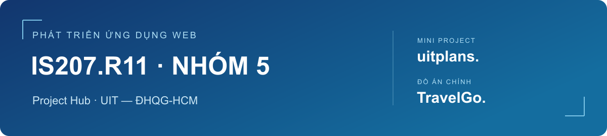
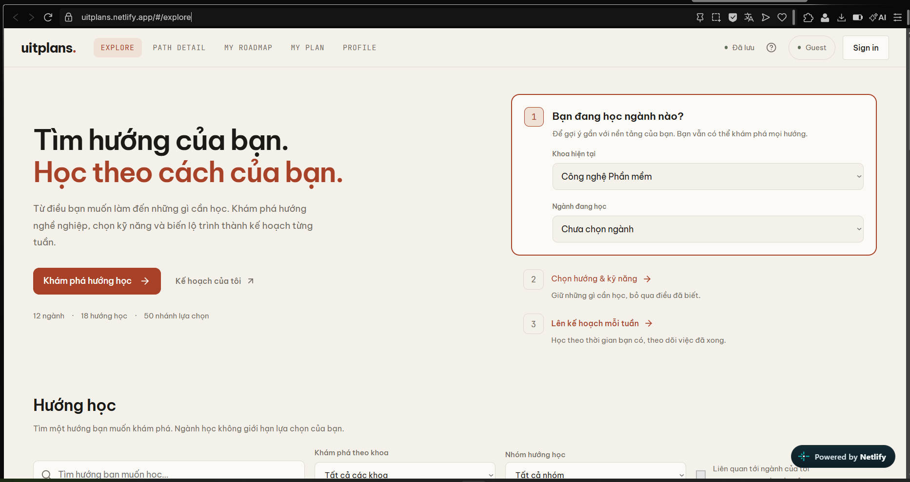
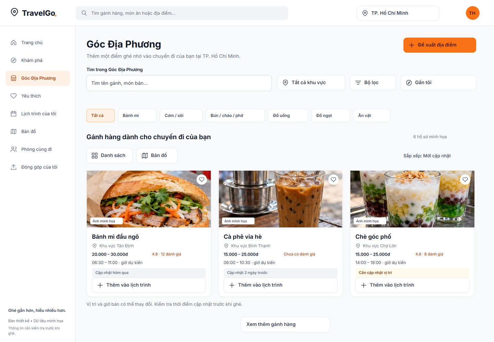

<p align="center">
  
</p>

# Project Hub · IS207.R11 — Nhóm 5

**[Mở Project Hub chính tại GitHub Organization IS207-R11-Nhom5](https://github.com/IS207-R11-Nhom5)**

Repository này lưu tài liệu và minh chứng của **Nhóm 5**, môn **Phát triển ứng dụng Web — IS207.R11**, Trường Đại học Công nghệ Thông tin, ĐHQG-HCM. Đường dẫn đã nộp vẫn được giữ để truy cập các tài liệu bên dưới.

Hub kết nối hai dự án của nhóm: **uitplans** là Mini Project đã có sản phẩm chạy online; **TravelGo** là đồ án chính đang phát triển. Mã nguồn, tài liệu sản phẩm và minh chứng được dẫn đến đúng nơi lưu trữ để giảng viên và các thành viên tiện theo dõi.

**Giảng viên hướng dẫn:** ThS. Tạ Việt Phương.

## Truy cập nhanh

| Nội dung | Liên kết |
| --- | --- |
| Website uitplans | [uitplans.netlify.app](https://uitplans.netlify.app/) |
| Mã nguồn Mini Project và hướng dẫn cài đặt | [haiphamt/uitplans](https://github.com/haiphamt/uitplans) |
| Mini Project và Product Brief | [Trang tài liệu uitplans trên Notion](https://app.notion.com/p/3ee533490aed81f7ab5eee549942f2c3) |
| Sơ đồ nghiệp vụ và kỹ thuật uitplans | [Activity, Sequence và Flowchart](https://uitplans.netlify.app/events.html) |
| Danh mục nội dung học | [Learning catalogue](https://uitplans.netlify.app/catalog.html) |
| Video kiểm soát AI và so sánh công cụ AI | [Thư mục Google Drive](https://drive.google.com/drive/folders/1nuZU3G-NEcOPM4UF4fP5bB-GgAus5R40?usp=drive_link) |
| Mã nguồn đồ án chính | [haiphamt/TravelGo](https://github.com/haiphamt/TravelGo) |
| Thiết kế TravelGo | [Figma TravelGo](https://www.figma.com/design/QYzdMjHKiquZjUAvHUdXhq/TravelGo?node-id=43-2) |

Bộ nộp Mini Project gồm [slides](minh-chung/uitplans/Slides_Mini_Project.pptx), [báo cáo kiểm thử](minh-chung/uitplans/Kiem_thu_Cong_Dinh.docx) và [các địa chỉ truy cập](minh-chung/uitplans/CAC_DIA_CHI_NOP_BAI_UITPLANS.txt). Nhóm đã demo trực tiếp cho giảng viên. Hai video kiểm soát AI và so sánh công cụ sẽ được bổ sung vào thư mục Drive đã liên kết.

## Thành viên

| STT | Họ và tên | MSSV | GitHub |
| :---: | --- | --- | --- |
| 1 | Phạm Tuấn Hải | 24520442 | [haiphamt](https://github.com/haiphamt) |
| 2 | Nguyễn Thị Quỳnh Hân | 24520013 | [QuynhHan486](https://github.com/QuynhHan486) |
| 3 | Phạm Công Định | 24520306 | [Dingglebell](https://github.com/Dingglebell) |
| 4 | Chung Minh Hiếu | 24520486 | [chungminhhieu2311-collab](https://github.com/chungminhhieu2311-collab) |
| 5 | Lê Nguyễn Hữu Hiếu | 24520495 | [lihanhutiu](https://github.com/lihanhutiu) |
| 6 | Triệu Quang Huy | 24520708 | [1can5ez](https://github.com/1can5ez) |

## Mini Project · uitplans

**Tên đề tài:** uitplans — Website khám phá hướng học và lập kế hoạch tự học cho sinh viên CNTT.

Sinh viên có thể biết ngành đang học nhưng chưa rõ hướng nghề nghiệp, những kỹ năng cần bổ sung hoặc thứ tự tự học. uitplans nối bước khám phá hướng học với lựa chọn kỹ năng, nguồn học và một kế hoạch theo quỹ thời gian mỗi tuần. Chọn ngành giúp ưu tiên gợi ý; người dùng vẫn có thể khám phá các hướng ngoài ngành.



### Phạm vi sản phẩm

- **Explore:** tìm kiếm và lọc 18 hướng nghề nghiệp, từ danh mục 6 khoa, 12 ngành và 50 nhánh học.
- **Path detail:** xem chặng học, nguồn học và mục tiêu chứng nhận từ các nhà cung cấp bên ngoài.
- **My roadmap:** chọn nội dung, đánh dấu phần đã biết, chọn nguồn và thiết lập số giờ học mỗi tuần.
- **My plan:** theo dõi việc học, tiến độ, ghi chú, backlog, chốt tuần và lịch sử; xem trước khi tạo lại kế hoạch.
- **Profile:** hồ sơ học tập, nhịp học, múi giờ và sao lưu/khôi phục dữ liệu.
- **Guest/Google:** dùng ngay bằng Guest; đăng nhập Google để lưu workspace theo tài khoản. Nhập dữ liệu Guest có xem trước và xác nhận.

Thời lượng là ước lượng; tiến độ do người dùng tự ghi nhận. Website dẫn đến nguồn học và chương trình chứng nhận bên ngoài, không cấp chứng nhận.

### Công nghệ và kiến trúc

**React 19 · TypeScript · Vite · CSS · Supabase Auth/PostgreSQL · IndexedDB · Netlify**

Guest lưu dữ liệu trong IndexedDB của trình duyệt. Tài khoản Google xác thực qua Supabase Auth và dùng workspace riêng trong PostgreSQL. Các thay đổi được điều phối qua workspace controller; chỉ báo lưu thành công sau khi kho dữ liệu xác nhận. Bản tài khoản kiểm tra chủ sở hữu và phiên bản trước khi ghi; nhận cập nhật bằng polling, không tự gộp xung đột.

- [Kiến trúc và vòng đời dữ liệu](https://github.com/haiphamt/uitplans/blob/main/docs/architecture.md)
- [Cài đặt, triển khai và cấu hình Google](https://github.com/haiphamt/uitplans/blob/main/docs/deployment.md)
- [Kiểm thử và giới hạn của minh chứng](https://github.com/haiphamt/uitplans/blob/main/docs/testing.md)

Node.js/npm phục vụ cài đặt, chạy môi trường phát triển và build. Bản sản phẩm hiện được triển khai dưới dạng frontend tĩnh; Node.js/Express trong danh mục là nội dung học.

### Phân công và kiểm thử theo module

Bảng dưới dựa trên phân công trong slide nhóm đã nộp. Cột kiểm thử làm rõ trách nhiệm rà soát từng phần, không tự xác nhận rằng mọi ca kiểm thử đều đã hoàn tất.

| Thành viên | Phần công việc trong sản phẩm | Kiểm thử và minh chứng cần phụ trách |
| --- | --- | --- |
| Phạm Tuấn Hải | Kiến trúc, UI, tích hợp, Google/cloud và triển khai | Rà luồng xuyên suốt Explore → kế hoạch; Google callback, lưu/tải lại tài khoản; kiểm tra bản triển khai và đối chiếu kiến trúc với code. |
| Nguyễn Thị Quỳnh Hân | Explore/Path detail; nội dung Backend, Frontend, Full-stack và UX | Kiểm tra tìm kiếm, bộ lọc khoa/ngành, chuyển hướng, nguồn học/chứng nhận và bố cục desktop/mobile; chọn ảnh UI cho Product Brief. |
| Phạm Công Định | My roadmap/planner; nội dung Mobile và Game; QA | Tổng hợp test case; kiểm tra tiên quyết, đã biết, lưu lựa chọn, tạo/xem trước kế hoạch; đối chiếu lỗi phát hiện với kết quả sửa và hồi quy. |
| Chung Minh Hiếu | My plan, tiến độ/tuần; nội dung Data Science, ML, MLOps và AI | Kiểm tra thêm/sửa việc, hoàn thành/bỏ hoàn thành, backlog, chốt tuần và lịch sử; đối chiếu báo cáo My Plan, giữ riêng kết quả fixture với hành trình thật. |
| Lê Nguyễn Hữu Hiếu | Profile/nhịp học; nội dung Analyst, BI, Data Engineering và BA | Kiểm tra lưu/hủy hồ sơ, múi giờ, nhịp học và mục tiêu chứng nhận; rà nội dung Profile và biên tập Product Brief theo minh chứng. |
| Triệu Quang Huy | Lưu trữ, backup/import/migration; hạ tầng và QA | Kiểm tra xuất/nhập JSON, xem trước nhập Guest, lỗi lưu và khả năng thử lại; rà các liên kết, quyền xem và tổng hợp AI Log của thành viên. |

Slide đã nộp ghi **“Nỗ lực” 100% cho từng thành viên**. Hub giữ đúng ý nghĩa nhãn này; không diễn giải thành tỷ trọng đóng góp của cả nhóm. Phần đóng góp cần đi kèm sản phẩm, commit/PR, tài liệu và minh chứng tương ứng.

### Kiểm thử và sử dụng AI

Báo cáo của Công Định ghi nhận các nhận xét về chức năng, giao diện và cách hiểu nghiệp vụ. Một lỗi chức năng được ghi nhận là **bỏ chọn ngành làm mất khoa đang chọn**. Bản sửa giữ khoa khi bỏ ngành; chủ động bỏ khoa vẫn xóa ngành theo hành vi dự kiến. Product Brief trình bày bước tái hiện, [ảnh trước/sau](assets/uitplans/bug-faculty-before-after.png) và [kết quả kiểm tra lại](minh-chung/uitplans/QA_bo_sung_20261011.md) cùng file Word gốc.

Hồ sơ My Plan ngày 11/10/2026 ghi nhận 39 trường hợp giao diện: 26 ca Guest/IndexedDB, 12 ca bằng fixture RAM và 1 ca mobile trong trình duyệt. Bộ kiểm tra domain/renderer 42/42 là kết quả riêng. Những số liệu này là hồ sơ lịch sử, không phải lần chạy mới ngày cập nhật Hub và không chứng minh đồng bộ trên hai thiết bị vật lý.

Nhóm sử dụng AI để hỗ trợ phát triển; nhóm chịu trách nhiệm lựa chọn, sửa đổi và kiểm chứng đầu ra. AI Development Log trong Product Brief dùng đúng sáu cột: **Nhiệm vụ · Công cụ AI · Đầu vào/Ngữ cảnh · Kết quả AI · Quyết định của nhóm · Kiểm tra/Xác minh**. Nhật ký ghi đúng công cụ của từng tương tác và dẫn tới minh chứng tương ứng.

Video kiểm soát AI và video so sánh hai công cụ được tập hợp trong thư mục Drive ở đầu trang. Phần so sánh chỉ ghi kết quả sau khi thực hiện cùng một nhiệm vụ với bối cảnh tương đương trên hai công cụ.

## Đồ án chính · TravelGo

**Tên đề tài:** TravelGo — Nền tảng khám phá địa điểm và lập lịch trình du lịch thông minh.

TravelGo hỗ trợ tìm địa điểm và lập lịch trình theo thời gian, ngân sách, sở thích. Phạm vi dữ liệu ban đầu là **TP.HCM và Đà Lạt**; **Góc Địa Phương** triển khai trước tại TP.HCM. Dữ liệu địa điểm sử dụng OpenStreetMap và đóng góp có kiểm duyệt; Google Maps được mở bằng liên kết để dẫn đường.



*Bản thiết kế giao diện, dữ liệu minh họa; không phải minh chứng toàn bộ chức năng đã triển khai.*

### Phạm vi dự kiến

- Tìm kiếm, lọc và xem chi tiết địa điểm; lưu yêu thích.
- Đánh giá 1–5 sao, nhận xét và ảnh; đề xuất thay đổi thông tin có kiểm duyệt.
- Lập lịch trình thủ công hoặc nhận gợi ý AI từ địa điểm có trong TravelGo.
- Cùng bạn bè bình chọn địa điểm và thống nhất lịch trình.
- Chủ cơ sở/người bán đề nghị quyền quản lý địa điểm; quản trị viên quản lý tài khoản và nội dung.

**Công nghệ đã chốt:** Angular/TypeScript, PHP/Laravel REST API, MySQL, Eloquent/migrations, Laravel Sanctum và Leaflet/OpenStreetMap.

Theo README hiện có, bản frontend khởi tạo ngày 18/10/2026 dùng dữ liệu minh họa và lưu thao tác trên trình duyệt; chưa kết nối Laravel/MySQL, xác thực, AI hoặc phòng cùng đi. Tiến độ mới hơn được cập nhật tại [repository TravelGo](https://github.com/haiphamt/TravelGo). Hub không xem phạm vi dự kiến là chức năng đã hoàn thành.

## Quy trình phối hợp

Các mục sau là **quy ước đề xuất để nhóm áp dụng và xác nhận**; không phải biên bản về lịch họp hoặc cam kết đã được cả nhóm thông qua.

### Công việc và tiến độ

1. Mỗi việc ghi rõ dự án, nội dung, người thực hiện, đầu ra, người rà soát và hạn nhóm thống nhất. Trao đổi nhanh qua nhóm Zalo; quyết định và minh chứng được tổng hợp lại tại Hub hoặc tài liệu dự án.
2. Cập nhật theo các trạng thái: **Chưa bắt đầu → Đang làm → Chờ kiểm tra → Hoàn thành**. Chỉ hoàn thành sau khi có đầu ra và kết quả rà soát.
3. Khi có vướng mắc hoặc có nguy cơ trễ, người phụ trách báo sớm để nhóm điều chỉnh phạm vi hoặc hỗ trợ.
4. Kết quả được ghi bằng link commit/PR, ảnh, báo cáo hoặc tài liệu; không chỉ ghi “đã xong”.

### Mã nguồn và review

- Tạo nhánh theo việc, chẳng hạn `feat/<noi-dung>`, `fix/<noi-dung>` hoặc `docs/<noi-dung>`.
- Gửi Pull Request với mô tả thay đổi và kết quả kiểm tra. Người rà soát đối chiếu với yêu cầu và chạy luồng liên quan trước khi gộp.
- Giải quyết xung đột và lỗi kiểm tra trước khi triển khai; cập nhật tài liệu khi hành vi hoặc cấu hình thay đổi.
- Không đưa token, OAuth secret, service role key hoặc mật khẩu vào repository. Dùng file môi trường cục bộ và chỉ công khai cấu hình mẫu phù hợp.

### Kiểm tra và triển khai

Với uitplans, repository hiện có GitHub Actions chạy:

```sh
npm ci
npm run check
npm run check:features
npm run build
```

Sau build, kiểm tra các luồng chính trên desktop/mobile và bản online. Với TravelGo, dùng lệnh và hướng dẫn trong README của dự án; quy trình frontend/API/database được cập nhật theo phần thực sự triển khai.

### Kiểm soát AI

- Thành viên hiểu và giải thích được phần mã hoặc quyết định đưa vào sản phẩm.
- Khi AI ảnh hưởng đến một quyết định hoặc chức năng quan trọng, lưu một dòng AI Log gồm đầu vào, đầu ra, quyết định và cách kiểm tra.
- Giữ minh chứng cho đầu ra bị từ chối/sửa lại, lỗi phát hiện và kết quả hồi quy.
- So sánh công cụ dựa trên cùng yêu cầu, dữ liệu và tiêu chí; không ghi nhận xét minh họa thành kết quả thử nghiệm.

## Tài liệu và minh chứng

| Nhóm tài liệu | Nơi theo dõi |
| --- | --- |
| Product Brief, user stories, kiến trúc, UI/UX, AI Log và test case của Mini Project | [Notion uitplans](https://app.notion.com/p/3ee533490aed81f7ab5eee549942f2c3) |
| Mã nguồn, README và tài liệu kỹ thuật uitplans | [Repository uitplans](https://github.com/haiphamt/uitplans) |
| Video kiểm soát AI và so sánh công cụ | [Drive video AI](https://drive.google.com/drive/folders/1nuZU3G-NEcOPM4UF4fP5bB-GgAus5R40?usp=drive_link) |
| Mã nguồn và phạm vi TravelGo | [Repository TravelGo](https://github.com/haiphamt/TravelGo) |
| Thiết kế TravelGo | [Figma](https://www.figma.com/design/QYzdMjHKiquZjUAvHUdXhq/TravelGo?node-id=43-2) |

Cập nhật nội dung Hub ngày **28/10/2026**. Các minh chứng kiểm thử giữ ngày thực hiện riêng; liên kết và trạng thái video được rà lại trước khi chốt hồ sơ.
